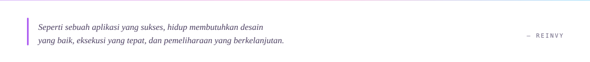

<div align="center">

<picture>
  <source media="(prefers-color-scheme: dark)" srcset="assets/hero-dark.svg">
  <source media="(prefers-color-scheme: light)" srcset="assets/hero-light.svg">
  
</picture>


<p>
  
  
  <a href="https://www.linkedin.com/in/bahrul-ulumul-haq-a8157a162"></a>
  <a href="https://x.com/reinvy"></a>
  <a href="https://medium.com/@reinvy"></a>
  <a href="https://wa.me/6289513339074"></a>
</p>

</div>

**Bahrul Ulumul Haq** — software engineer from Indonesia. I build mobile apps in Flutter and the backends behind them in Express, Spring Boot, and PostgreSQL.

Most of my work now is private product work: payroll, fleet, talent, and academy systems. The repositories below are the public half of the same standard — tested, documented, and runnable from a fresh clone.

---

## 01 · `whoami`

I like the unglamorous part of software: the invariant that still holds at 03:00, the migration that ran clean, the README that lets a stranger run the app without asking me a question. That is the bar I build to.

- **Now** — private payroll, fleet, talent, and academy platforms: Flutter on the client, Express and Spring on the server.
- **Open source** — [`rakitin`](https://github.com/Reinvy/rakitin), a CLI that upgrades existing Express projects instead of replacing them; [`ReinvyLibrary`](https://github.com/Reinvy/ReinvyLibrary), hundreds of bilingual engineering documents.
- **Open to** — open-source collaboration. Bring a hard backend problem.

---

## 02 · `selected work`

<sub>Six repositories that clear the bar — clone, run, and read them. No dead demos.</sub>

<table>
  <tr>
    <td width="50%" valign="top">
      <h3><a href="https://github.com/Reinvy/rakitin">rakitin</a> <sub>CLI</sub></h3>
      <p><b>Integration-first boilerplate for Express.</b> It inspects the project you already have, then generates modules, middleware, and routes additively — between explicit markers. Nothing is rewritten behind your back.</p>
      <p><sub><code>Node.js</code> <code>Express</code> <code>npm</code></sub></p>
      <p><sub><a href="https://www.npmjs.com/package/rakitin">npm ↗</a> &nbsp;·&nbsp; <a href="https://github.com/Reinvy/rakitin">source ↗</a> &nbsp;·&nbsp; MIT · CI-tested</sub></p>
    </td>
    <td width="50%" valign="top">
      <h3><a href="https://github.com/Reinvy/next-fincorp">FinCorp</a> <sub>accounting</sub></h3>
      <p><b>A double-entry accounting monolith.</b> Sales, purchases, cash and bank, fixed assets, tax, and financial statements read one ledger. Ten invariants are enforced in code; the demo company is seeded, and the flows are covered by Playwright end-to-end tests.</p>
      <p><sub><code>Next.js 16</code> <code>Prisma</code> <code>PostgreSQL</code></sub></p>
      <p><sub><a href="https://github.com/Reinvy/next-fincorp">source ↗</a> &nbsp;·&nbsp; e2e-tested · seeded demo</sub></p>
    </td>
  </tr>
  <tr>
    <td width="50%" valign="top">
      <h3><a href="https://microapp-studio.vercel.app">MicroApp Studio</a> <sub>AI builder</sub></h3>
      <p><b>Prompt → schema → runnable micro-app.</b> A drag-and-drop canvas, a Monaco playground for custom JS nodes, and IndexedDB persistence. No backend, no login; apps keep working offline.</p>
      <p><sub><code>Next.js</code> <code>TypeScript</code> <code>IndexedDB</code></sub></p>
      <p><sub><a href="https://microapp-studio.vercel.app">live ↗</a> &nbsp;·&nbsp; <a href="https://github.com/Reinvy/microapp-studio">source ↗</a> &nbsp;·&nbsp; local-first</sub></p>
    </td>
    <td width="50%" valign="top">
      <h3><a href="https://reinvy-library.vercel.app">ReinvyLibrary</a> <sub>library</sub></h3>
      <p><b>An open-source engineering library.</b> Tutorials, syllabi, cheat sheets, and guides with one frontmatter schema and parallel English/Indonesian editions — validated in CI and served through a searchable Next.js site.</p>
      <p><sub><code>Markdown</code> <code>Next.js</code> <code>FlexSearch</code></sub></p>
      <p><sub><a href="https://reinvy-library.vercel.app">live ↗</a> &nbsp;·&nbsp; <a href="https://github.com/Reinvy/ReinvyLibrary">source ↗</a> &nbsp;·&nbsp; MIT</sub></p>
    </td>
  </tr>
  <tr>
    <td width="50%" valign="top">
      <h3><a href="https://aether-hud-lyart.vercel.app">AETHER-HUD</a> <sub>design system</sub></h3>
      <p><b>A portfolio built like a AAA game HUD.</b> Obsidian and Imperial Gold, chamfered glass panels, HUD indicators, and its own CMS dashboard — a design system first, a portfolio second.</p>
      <p><sub><code>Next.js 16</code> <code>Tailwind v4</code> <code>Framer Motion</code></sub></p>
      <p><sub><a href="https://aether-hud-lyart.vercel.app">live ↗</a> &nbsp;·&nbsp; <a href="https://github.com/Reinvy/aether-hud">source ↗</a></sub></p>
    </td>
    <td width="50%" valign="top">
      <h3><a href="https://github.com/Reinvy/express-storage-module">Storage module</a> <sub>REST API</sub></h3>
      <p><b>A complete file-storage service.</b> JWT-consuming auth, IP whitelisting, upload limits, and Prisma/MySQL persistence — with every endpoint documented in a Postman collection.</p>
      <p><sub><code>Express</code> <code>Prisma</code> <code>MySQL</code></sub></p>
      <p><sub><a href="https://github.com/Reinvy/express-storage-module">source ↗</a> &nbsp;·&nbsp; MIT · Postman-ready</sub></p>
    </td>
  </tr>
</table>

<sub><b>From FinCorp's seeded demo</b> — sales invoice, chart of accounts, and profit &amp; loss.</sub>

<table>
  <tr>
    <td width="33%" valign="top"><a href="https://github.com/Reinvy/next-fincorp/blob/main/reference/buat_faktur_penjualan_fincorp/screen.png"></a></td>
    <td width="33%" valign="top"><a href="https://github.com/Reinvy/next-fincorp/blob/main/reference/daftar_akun_coa_fincorp/screen.png"></a></td>
    <td width="33%" valign="top"><a href="https://github.com/Reinvy/next-fincorp/blob/main/reference/laporan_laba_rugi_fincorp/screen.png"></a></td>
  </tr>
</table>

<sub><b>Try the smallest one first</b> — rakitin runs inside an existing Express project:</sub>

```bash
npx rakitin   # add a module; your code stays yours
```

---

## 03 · `stack`

<sub>Tools I reach for by default — not a completion checklist.</sub>

<sub>**Mobile**</sub><br>
<picture>
  <source media="(prefers-color-scheme: dark)" srcset="https://skillicons.dev/icons?i=flutter%2Cdart%2Candroidstudio%2Cfigma&amp;theme=dark">
  
</picture>

<sub>**Backend**</sub><br>
<picture>
  <source media="(prefers-color-scheme: dark)" srcset="https://skillicons.dev/icons?i=nodejs%2Cexpress%2Cjava%2Cspring%2Cprisma%2Cpostgres%2Cmysql&amp;theme=dark">
  
</picture>

<sub>**Frontend**</sub><br>
<picture>
  <source media="(prefers-color-scheme: dark)" srcset="https://skillicons.dev/icons?i=ts%2Cjs%2Cnextjs%2Creact%2Ctailwind%2Chtml%2Ccss&amp;theme=dark">
  
</picture>

<sub>**Tooling**</sub><br>
<picture>
  <source media="(prefers-color-scheme: dark)" srcset="https://skillicons.dev/icons?i=git%2Cgithub%2Cdocker%2Cvercel%2Clinux%2Cidea&amp;theme=dark">
  
</picture>

---

## 04 · `signal`

<sub>Pulled live from the GitHub API — no hand-picked numbers.</sub>

<p align="center">
  <picture>
    <source media="(prefers-color-scheme: dark)" srcset="https://streak-stats.demolab.com?user=Reinvy&amp;theme=tokyonight&amp;disable_animations=true">
    
  </picture>
</p>

<p align="center">
  <picture>
    <source media="(prefers-color-scheme: dark)" srcset="https://github-profile-summary-cards.vercel.app/api/cards/profile-details?username=Reinvy&amp;theme=tokyonight">
    
  </picture>
</p>

---

<p align="center">
<picture>
  <source media="(prefers-color-scheme: dark)" srcset="assets/quote-dark.svg">
  <source media="(prefers-color-scheme: light)" srcset="assets/quote-light.svg">
  
</picture>
</p>
